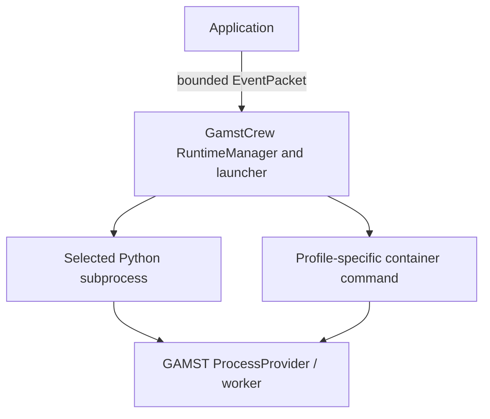

# GamstCrew

Unified runtime orchestration for GAMST.

GamstCrew is the deployment and lifecycle companion to the GAMST SDK. The
projects have deliberately different responsibilities:

- **GAMST** owns capability definitions, provider validation, provider wire
  framing, timeouts and observation contracts.
- **GamstCrew** selects a compatible runtime profile, starts and stops workers,
  bounds queues and transport, records health, and accounts for declared
  resources.

Crew does not replace the SDK's provider contract, install model weights, or
turn profile metadata into host acceptance evidence. A profile is ready only
after its declared compatibility and artifact checks pass; model quality and
target-host acceptance remain separate gates.

## Runtime shape

The application talks to Crew through bounded packets. Crew supervises the
selected GAMST worker through either a host subprocess or a deployment command
that starts a container:

The packet contract and worker lifecycle stay the same across both launch
forms. The deployment layer decides whether the command runs directly on the
host or inside a container; Crew does not silently change that choice.

## Why Crew exists

Provider environments have different Python versions, native libraries,
accelerators and model artifacts. Loading every provider into the application's
environment would make those dependencies compete for one import graph and one
failure domain. Crew gives each selected provider runtime an explicit identity
and lifecycle while keeping GAMST's provider semantics in the core SDK.

`RuntimeManager` provides one bounded queue and health record per registered
runtime. `ProcessRuntime` and `CoreProviderRuntime` supervise workers in their
selected Python environments; `CoreProviderRuntime` delegates provider
validation and observation handling back to GAMST. Startup, shutdown, bounded
restarts, stderr capture, packet integrity, and optional resource reservations
remain visible to the operator.

## Subprocess isolation and Docker isolation

These are related but different boundaries:

- A **subprocess runtime** is the default process-level boundary. It has its
  own interpreter, imports and crash boundary, but shares the host kernel and
  ordinary host filesystem with the parent. Crew communicates over bounded
  bounded stdin/stdout. The separate `JsonlUnixServer` seam provides local
  Unix-socket request/response transport when that adapter is selected. This
  is enough to keep incompatible Python packages apart and to supervise a
  worker cheaply.
- A **container runtime** adds an image and container namespaces around a
  command. It is useful when the provider needs a pinned Linux userspace,
  CUDA/NVIDIA/Triton stack, system libraries, or a repeatable image that the
  host Python environment cannot provide. The container still runs a provider
  process, so Crew's process lifecycle and packet contract remain relevant.

The `linux-cuda` catalog profile declares
`docker+nvidia-toolkit+triton` because that stack commonly needs an image and
GPU runtime integration. The macOS Apple Silicon, Linux CPU, Windows
CPU/DirectML and Jetson profiles declare their corresponding host runtime
families instead. The catalog is descriptive: `launch_profile()` validates the
profile and supervises the supplied `argv`; it does not install Docker,
download weights, or invent a container command.

Use Docker when the selected profile requires that packaged OS/accelerator
stack or when deployment needs image-level reproducibility. Use a host
subprocess when the profile's native runtime is compatible and a container
would add no useful boundary. Either way, pass the worker's bounded readiness
and packet protocol through the launch command.

## Why not put every provider in one container?

A universal image would couple providers that often have incompatible Python
versions, ABI constraints, CUDA/TensorRT revisions, CPU-only and GPU-only
assumptions, or different license and artifact locks. It would also enlarge
the failure and upgrade domain: one native-library failure or image update
could take unrelated providers offline. Per-runtime queues, resource
reservations, restart policy and provenance are harder to reason about when
all workers share one process environment.

The rule is not “one container per model” as a blanket requirement. Providers
may share a container when they have the same tested image, dependency lock,
accelerator contract and lifecycle. The safe default is one provider runtime,
or one deliberately grouped set, per compatible profile. Separate runtimes
still exchange the same bounded `EventPacket` contract, whether they happen to
be separate host processes or separate containers.

## Further reading

- [Runtime manager and lifecycle](docs/runtime-manager.md)
- [OS/runtime profiles and preflight](docs/os-profiles.md)
- [Packet contract and transport integrity](docs/packet-contract.md)
- [Resource reservations and host limits](docs/resource-allocation.md)
